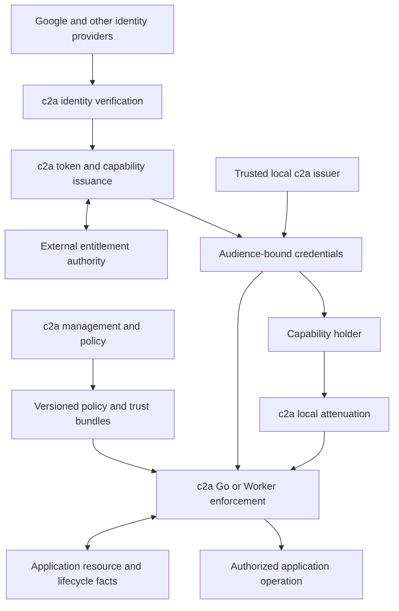

# c2a as a modular access-issuance, authorization, and delegation platform

Design direction, 2026-11-04. This document supersedes the earlier recommendation to use Auth0 for login and to retain each application's independent authorization system as the destination. The [readiness plan](PRODUCTION_READINESS_PLAN.md) and [project survey](PROJECT_ADOPTION_PLAN.md) remain useful implementation inventories; this document defines the intended architecture.

Governing constraints: c2a never owns user storage. It consumes validated identity evidence and calls an external service for effective permissions, then issues credentials and evaluates access remotely or inside the application. Account lifecycle, memberships, and entitlement assignments remain external. Simple deployment, including Cloudflare, and no mandatory extra evaluator daemon are core requirements. The [evaluation](C2A_EVALUATION.md) assesses this narrower product boundary and its alternatives.

## The destination

c2a should supply the access infrastructure that these projects would otherwise build individually or obtain through a bundled platform such as Auth0. It owns identity-evidence verification, the external entitlement contract, credential issuance, permission definitions, policy evaluation, and constrained delegation. Login adapters can integrate upstream providers; accounts and entitlement assignments remain with external services. Applications adopt c2a contracts and libraries without migrating their users.

We control JobDB, Gitvend, and Cortex. That makes coordinated replacement practical: their custom permission machinery can become reusable c2a functionality, with application adapters supplying resource information and enforcing decisions at the correct points. Compatibility layers are a migration tool, not the final architecture.

Three choices follow:

1. **Build c2a's product on permissively licensed protocol and cryptographic components.** Google can supply identity evidence and an application-owned service can supply entitlements. Neither Auth0 nor c2a needs to own a second copy of the application's users.
2. **Make restricted delegation a first-class part of c2a.** JWT access tokens, Cedar decisions, and locally attenuable capabilities solve different parts of the problem. c2a needs all three concepts, with explicit composition rules.
3. **Share the implementation and contracts without requiring a central service call for every operation.** The same c2a authorization and capability modules should run inside Go services or behind a Worker adapter. Local credential issuance should be a supported deployment mode.

“c2a-centric” should mean one permission model, one credential lifecycle, and one set of security semantics. It need not mean one wire format, one process, or one database containing every application's operational state.

## Decompose by responsibility

The following are logical modules. Several can ship in one binary or Worker initially; making them separate network services is optional.

| Module | Owns | Important boundary |
| --- | --- | --- |
| Identity and entitlement adapters | Validate namespaced subject references and request grants from external services | No c2a accounts, profiles, passwords, memberships, or identity-linking database |
| Authentication and federation adapters | Google/other OIDC verification, authentication transactions, assurance | Verifies upstream identity; account lifecycle stays external |
| Browser integration | Login/callback integration and application session adapters | A valid session is not permission to every service; session ownership/storage is explicit and does not create a c2a user directory |
| Client and token service | Registered clients, audiences, JWT issuance, refresh, key lifecycle, authorized token exchange | A caller cannot choose arbitrary claims, identities, or audiences |
| Permission and policy management | Service vocabularies, grant schemas, role definitions, Cedar policy, review, publication | User/group assignments come from the external entitlement authority; c2a does not become a second source of truth |
| Capability and delegation | Root grants, attenuation, caveats, proof verification, lineage, lifetime rules | Holders can reduce authority without receiving an issuer key |
| Enforcement SDK | Credential admission, policy evaluation, mandatory restrictions, typed decisions, hooks for live facts | Application facts come from trusted code, not token-supplied assertions |
| Distribution and operations | Versioned bundles, trust configuration, audit, revocation signals, storage adapters | Published policy and live application state have different freshness requirements |

The current repository already supplies substantial parts of policy management, Worker enforcement, identity/token issuance, and distribution. The main architectural gaps are the full login/client protocol, shared Go runtime, a generalized capability module, and clear contracts between them.

The current D1 identity/subject/membership implementation must be decoupled from issuance to meet this boundary. The external claim-preview hook alone does not remove local user dependencies. Existing account-management functionality is outside the target c2a core; do not preserve it as an optional c2a user store. External services own any retained account functionality.

Provide independently useful combinations: evaluator plus externally issued credentials; local issuer plus external grants and embedded evaluation; a Worker deployment; or optional remote evaluation and management. D1/R2 remain valid policy/operational adapters, but the smallest deployment should accept a local bundle and external identity/entitlement configuration. The Go evaluator and local issuer consume storage/key interfaces rather than requiring Cloudflare bindings or a database.



## Replacing bundled access infrastructure without owning users

There are two distinct OIDC roles:

- **Upstream client:** a c2a adapter signs a user in with Google or another identity provider and verifies the namespaced external subject. Application-owned services resolve identity links and entitlements.
- **Downstream provider:** an optional protocol module exposes standard OAuth/OIDC flows to applications using those external authorities. That is a separate scope decision, not a prerequisite for accepting an identity proof and issuing an API credential.

The current `/auth/federated/oidc` exchange is a starting point for the upstream role. It is not a complete downstream OAuth/OIDC authorization server and currently includes local identity dependencies. c2a replaces selected access functions of an identity platform; it intentionally does not replace its user directory, account recovery, or profile management. A complete downstream provider should only be added when an adoption requires it.

For Cortex, the intended flow can be Cortex → reusable login adapter → Google → identity verification → external project-entitlement service → c2a issuance → Cortex. The adapter avoids repeated protocol implementation without creating c2a users. The management console uses separate audience and administrator grants from its external authority. Neither browser gets signing keys or refresh material intended only for a backend.

The first useful boundary is upstream identity verification, a typed external entitlement lookup, audience-bound issuance, and evaluation. A browser adapter uses authorization code with PKCE, exact redirects, state/nonce transaction binding, and CSRF protection. Invitations, account linking, passwords, passkey registration, recovery, and user provisioning remain external permanently. Define refresh/logout and access-removal behavior without implying that c2a must host the account or application session database.

### Reusable components

These are candidates, with upstream-declared licenses checked on the document date. Pin and review the actual versions and dependencies selected for release. None is a complete c2a product by itself.

| Component | License | Potential use |
| --- | --- | --- |
| [coreos/go-oidc](https://github.com/coreos/go-oidc) | Apache-2.0 | Upstream OIDC client and identity-token verification in a Go login module; not an OIDC server |
| [Ory Fosite](https://github.com/ory/fosite) | Apache-2.0 | Candidate only if a downstream OAuth/OIDC server is required; protocol persistence and client policy are separate from externally owned users |
| [jose](https://github.com/panva/jose) | MIT | Existing TypeScript/Worker JWT and key handling; does not supply the full login protocol |
| [cedar-go](https://github.com/cedar-policy/cedar-go) | Apache-2.0 | Native Go policy evaluation, subject to parity with our published Cedar subset |
| [go-macaroon/macaroon](https://github.com/go-macaroon/macaroon) | BSD-3-Clause | Existing JobDB foundation for first-party capability attenuation |
| [Biscuit Go](https://github.com/eclipse-biscuit/biscuit-go) | Apache-2.0 | Candidate if public-key-verifiable attenuation becomes necessary |

Prefer composition of these libraries behind c2a contracts. A Go protocol module using Fosite is an option if downstream OAuth/OIDC is needed; basic issuance does not require it. If login endpoints must run on Workers, evaluate a supported TypeScript client/protocol implementation rather than assuming a Go library can run there. Keep issuer and external-identity trust contracts consistent across deployments.

Do not adopt a c2a identity directory or user-entitlement store just because a framework offers one. External services remain authoritative. c2a stores policy/vocabulary configuration and necessary operational state, with a minimal bundle-based path that does not require managed storage.

## Identity tokens, access grants, and capabilities

A JWT is a signed statement. A holder cannot safely narrow a normal signed JWT by editing its claims; it needs a newly issued token or a distinct proof scheme. Cedar evaluates an authorization request. It does not establish that a delegation chain is authentic or that removing a restriction would break a credential's proof.

A macaroon supplies that missing attenuation property: a bearer can append caveats locally, without the issuer's root key, and a verifier checks the resulting proof and restrictions. See the [original macaroon paper](https://research.google/pubs/macaroons-cookies-with-contextual-caveats-for-decentralized-authorization-in-the-cloud/). This should become a c2a capability profile rather than remain a private JobDB format.

Recommended initial credential families:

| Credential | Purpose | Issuance and use |
| --- | --- | --- |
| Session/identity result | Establish who signed in and with what assurance | External identity plus protocol adapter; external entitlements determine what c2a may issue |
| c2a access JWT | Routine service/API access with a specific audience | Central or trusted local issuer; independently verifiable with public keys |
| c2a restricted capability | Delegated actions on bound resources, optionally tied to a live parent | Authorized root issuer; holders attenuate locally; application uses c2a verification and restriction evaluation |

The existing `azs` encoding can remain a compact access-token projection. It should not become the universal model for delegated authority. Role identifiers can change meaning as policy changes; an immutable delegation ceiling needs explicit actions/resource constraints or an immutable referenced grant version. A role expansion must not silently expand every old capability.

Local tooling needs two visibly different operations: **mint**, which requires issuer authority, and **attenuate**, which requires only a suitable parent capability. “Give every worker a JWT signing key” would erase this distinction and defeat limited delegation.

## What JobDB already demonstrates

At the reviewed [JobDB source revision](https://github.com/colony-2/jobdb/tree/a21636d234cef6e241dcc1e2da41fe209b8f3ac5), local attenuation is implemented, not just proposed. Its [design document](https://github.com/colony-2/jobdb/blob/a21636d234cef6e241dcc1e2da41fe209b8f3ac5/docs/DESIGN-Offline-Lease-Delegation.md) explains the lifecycle, while [attenuation.go](https://github.com/colony-2/jobdb/blob/a21636d234cef6e241dcc1e2da41fe209b8f3ac5/pkg/jobdb/runtime/remote/attenuation.go) and [delegation_server.go](https://github.com/colony-2/jobdb/blob/a21636d234cef6e241dcc1e2da41fe209b8f3ac5/pkg/jobdb/runtime/remote/delegation_server.go) define the current implementation. The document describes v1 prefixes; the reviewed code has `jdb-o2.` / `jdb-m2.` and cell-bound v2 purposes. Migration must follow code and wire fixtures, not assume the prose is the current serialization specification.

Its important semantics are:

- A root is bound to a specific service/trust domain, tenant, job, execution lease, worker, and cell context.
- A child can restrict submission targets, secret names, chapter reads, and task-outcome chapter writes. Omitted actions deny. Further derivation cannot widen authority.
- A child may have an absolute deadline; omitting one does not erase an ancestor deadline. Every use still depends on the exact backend parent lease being live.
- Owner-token expiry or rotation is distinct from parent-lease liveness. Children can remain valid while that same lease is maintained, without possessing the owner token or inheriting its short access-token expiry.
- A child cannot renew the parent lease, become its owner, or acquire owner/admin actions. Child inspection/renewal does not extend its authority.
- Local derivation requires no network call; validation of the live parent does. Offline creation is not evidence that the parent is still valid.

Keep these semantics while moving the security implementation into c2a. Replacing the credential with a ten-minute JWT and a list of roles would lose meaningful behavior.

Macaroons also constrain the deployment design. Ordinary MAC verification requires secret key material that can also mint authority. Do not distribute a platform-wide macaroon root key to unrelated Go services and Workers. Initially use service-specific keys and issuer ceilings, and verify JobDB-bound capabilities inside JobDB's trusted c2a runtime. Standardize key rotation and profiles in c2a without making every verifier a global issuer.

[Biscuit](https://doc.biscuitsec.org/reference/specifications) offers attenuation with public-key verification and a Datalog-based restriction language. It is worth evaluating for independently verifying capabilities across services, but introduces another language/runtime alongside Cedar. Prefer extracting JobDB's working first-party macaroon approach first. Keep the credential-verifier interface replaceable, and use an explicit trusted exchange for cross-service authority. Do not design a custom JWT nesting or signature-chain protocol to avoid choosing a maintained primitive.

## How Cedar and capabilities compose

For a capability-authenticated operation, the intended decision is:

```text
allow = valid credential proof and purpose/audience
    AND issuer is trusted for this authority
    AND current applicable c2a service policy permits the operation
    AND immutable root grant covers the operation
    AND every authenticated attenuation step permits the operation
    AND required live application conditions hold
```

All terms must refer to the same normalized action, resource, scope, and trusted context. A denial at any layer ends the operation. An access-JWT request uses its defined identity/entitlement admission policy rather than an invented capability root. The admission path is explicit for each credential family; accepting one format must not let a caller bypass restrictions attached to another.

The current policy can reduce a capability's usable authority but cannot enlarge its immutable ceiling. Define capability-specific admission policy so a child is not accidentally required to reproduce an expired human/owner login session. A valid JobDB grant can authorize its holder under c2a policy while still requiring the live lease and all restrictions. The root's subject/lineage identifies the source of authority; a bearer token alone does not prove the identity of the process presenting it.

Do not concatenate parent and child Cedar `permit` statements and expect attenuation: combining permits can broaden the allowed set. c2a should implement bounded, typed restrictions and conjunctive evaluation. Initial selectors can cover exact action/resource sets, scope IDs, path/ref constraints, ordinal ranges, deadlines, and registered live-condition references. Unknown restriction types or versions must fail closed.

Where subset checking is straightforward, reject widening at derivation time as JobDB does today. For richer selectors, always retain and evaluate every ancestor restriction. Arbitrary Cedar-policy containment or arbitrary regex containment should not be a prerequisite for safe attenuation. Local validation is convenience; the verifier independently checks the complete proof and effective restrictions. Bound chain depth, token bytes, selector counts, and evaluation cost.

c2a needs an explicit live-condition contract, for example a registered `jobdb.execution-lease` resolver. The credential names the condition and bound identifiers; trusted application code checks the backend. It must not supply an arbitrary URL for the runtime to fetch or a token claim such as `lease_live=true` that is taken on trust. Unknown conditions and unavailable mandatory checks deny access.

Freshness is specific to the condition. Cached policy may have a bounded deployment window. Lease validation must retain JobDB's existing authoritative checks, including checks around mutations and secret disclosure. A generic preflight authorization decision cannot eliminate application transaction races or substitute for validating the same lease when an operation commits.

## Make application permissions c2a permissions

Applications retain ownership of their vocabulary, resource facts, and user-specific entitlement assignments. c2a owns the registered grant schema, evaluation, credential representation, and delegation lifecycle. The external service selects effective grants using that schema; it need not implement token verification, attenuation, or per-operation policy evaluation. An application-specific vocabulary is not an independent enforcement implementation.

For example, register versioned actions such as `jobdb.jobs.submit`, `jobdb.secrets.resolve`, `jobdb.chapters.read`, `gitvend.refs.update`, and `cortex.reviews.respond`. Model tenant, cell, job, repository, ref, and review resource types with documented attributes and relations. The exact names are proposed. Neither every operation nor every resource should be forced into a filesystem path permission.

| Moves into c2a | Stays with the application |
| --- | --- |
| Who may submit into which cells; which secret names a grant permits | Resolve the actual cell/job and verify a lease is live |
| Root permission ceilings, caveat encoding/intersection, proof verification, delegation SDK | Maintain, cancel, complete, or replace the execution lease |
| Git repository/ref grants, denies, issuer ceilings, token verification | Parse Git requests and determine every ref/object operation being attempted |
| Evaluating externally supplied grants, review permission semantics, verified actor references | Own subject/role assignments; persist review responses and validate form/state |
| Signing/key profiles, credential renewal/exchange rules, security audit fields | Secret retrieval, upstream GitHub credentials, job storage and transaction invariants |

Provider-specific resource policy may be expressed through a registered c2a extension; no extension may silently add authority after c2a denies. Implement selector semantics once in the shared module, not three times in application helper functions. Keep domain fact construction and the points where a check must run in each application.

For Go, ship a core evaluator/capability library and typed integrations. Middleware verifies credentials and installs a request security context. Internal APIs authorize concrete operations; query/acquisition adapters apply authorized constraints before pagination or leasing work. c2a should not claim a generic Cedar decision automatically produces safe SQL filters. Build the bounded query adapters each application needs and test their equivalence to per-resource authorization.

The Worker implementation uses the same profiles and conformance fixtures. Unsupported capability types should be rejected or routed to an explicitly trusted verifier, never downgraded to a plain JWT. This is a stronger SDK than an HTTP authentication shim.

## Full adoption by the three projects

### JobDB becomes a c2a-native resource service

Move access authentication, capability proof handling, selector validation/intersection, issuer policy, and permission decisions into c2a packages. JobDB registers its operations and supplies lease/cell/job facts. Its existing authority context can initially be populated by an adapter, then replaced with typed c2a authorization context at internal boundaries.

The public lease APIs can stay familiar: `CreateDelegation`, export/import, and restricted lease handles can wrap c2a capabilities. The owner and child profiles may remain distinct within c2a. A namespace or wire prefix change is secondary to removing JobDB's independent token and permission implementation.

At acquisition, trusted JobDB code requests issuance from an embedded c2a issuer constrained to JobDB authority. External grants and c2a policy determine the permitted root ceiling; JobDB binds it to the exact acquired lease. A client cannot self-assert those facts to the issuer. Any explicit `capability.issue`/cross-service exchange permission is separate from a holder's ability to append restrictions to an existing capability.

Include the finer semantics in the migration: exact selectors, ranges, cell identity, empty grants, absent deadlines, parent cancellation/replacement, owner renewal, secret-provider limits, and child-only ingress. Root-cell submission rules should become explicit c2a policy where they express authority; the backend still enforces actual cell existence, revision, and lifecycle invariants.

Completion means JobDB has one c2a security path throughout HTTP and internal resource operations, and its former permission package no longer independently decides access. Preserve its tests as shared c2a capability tests plus JobDB fact/transaction integration tests.

### Gitvend becomes a c2a-native protocol enforcement adapter

Replace `grant.permissions`, custom issuer ceilings, and the separate rule evaluator with a c2a service vocabulary, policies, credential verifier, and delegation selectors. The existing permission-string syntax can be a temporary importer or CLI convenience that compiles into canonical c2a grants. It should not remain a second authoritative policy store.

Move its useful repository/ref matcher into a c2a extension if necessary. Preserve its exact semantics and deny precedence through fixtures; do not approximate regex/ref rules with path prefixes. Each parsed ref update, discovery result, delete, or creation request becomes a structured authorization operation. Gitvend still parses the Git protocol, keeps upstream credentials, and refuses an entire push when any required update is denied before forwarding.

The Git credential helper can carry a c2a credential as the HTTPS password. Applications need not expose JWT/macaroons to Git itself. Retire the dedicated Gitvend signer once the c2a CLI and JobDB integration can issue the required audience-bound credentials. Existing short-lived JWTs can be supported for a bounded migration window, not kept as the long-term control plane.

The JobDB Gitvend plugin becomes a c2a issuance/exchange adapter: it presents authenticated lease authority, and c2a applies explicit policy for the target repository/ref grant. The useful lease-bound issuance behavior survives, while private key management, permission computation, and token formats become c2a-owned.

This does not make Git branch permissions an object-confidentiality boundary. Git protocol behavior and upstream constraints still determine which objects a repository read can expose.

### Cortex becomes a c2a client and resource service

Cortex removes its email-cookie identity convention, uses verified upstream identity through a reusable adapter, and asks an external application-owned service for grants before c2a issues authority. Project membership stays external; submission, review, and administrative permissions are evaluated by c2a using explicit tenant/cell mappings. Authentication applies to downloads, SSE, and externally mounted c2j input routes as well as the visible UI API.

For downstream JobDB actions, prefer a controlled c2a delegation/exchange when per-user authority should survive the hop. Bind the human subject, Cortex service actor, target audience, and resource limits in the issued authority. JobDB then evaluates a c2a credential rather than trusting a forwarded email/header. Background actions can use separate c2a service identities with their own policy.

This removes the need for Cortex to implement its own token issuer or a second enforcement role table. Its application-owned entitlement service remains the authority for membership and assignments. Cortex validates the selected project/job and records the verified actor when saving application data.

## Cross-service delegation needs an explicit policy

Attenuation does not turn JobDB authority into Gitvend authority. An audience-bound macaroon cannot acquire a new audience or a Git write grant by adding a caveat. A `secrets.resolve` grant is not inherently permission to mint any credential named in the request.

Use an authenticated c2a exchange/issuance operation, either embedded in the trusted JobDB plugin path or hosted behind an authenticated service boundary. Its policy checks the parent proof, target audience, tenant/cell/repository mapping, requested actions, current live conditions, and the issuer's ceilings. It then issues a new target-service credential with explicit lineage and preserved or stronger restrictions. Each policy-defined translation needs a tested rule; permissions in different service vocabularies cannot be intersected by comparing strings.

For the example Human → Cortex → JobDB → worker → Gitvend:

1. The human supplies verified upstream identity; the external entitlement service authorizes grants for a specific project and c2a issues the constrained credential.
2. Cortex obtains bounded JobDB authority through an authorized exchange and submits the job.
3. JobDB acquires work for an authorized worker and issues a c2a root bound to that execution lease.
4. The worker attenuates a child locally, perhaps to read two chapters and resolve one named credential.
5. The trusted credential provider uses an explicit c2a rule to issue Gitvend authority for the job's allowed repository/refs.
6. Gitvend verifies that target credential and authorizes the concrete Git operations using c2a.

Every delegated hop needs a policy-defined ceiling and must preserve the parent's applicable tenant, resource, deadline, and mandatory live-condition restrictions through the explicit translation. If an operator needs independent authority, that is a separately authorized root issuance, not attenuation disguised as exchange. Record root/parent and actor lineage without embedding reusable ancestor bearer credentials.

There is a fundamental lifetime choice at step 5:

- **Snapshot issuance:** a short-lived Gitvend JWT expires no later than the lease authority observed at issuance. Lease cancellation afterward cannot instantly revoke that JWT; there is a bounded residual access window.
- **Live dependency:** Gitvend additionally obtains authenticated evidence of the parent lease's current validity, directly or through c2a. This adds availability/latency dependencies and a defined caching bound.

c2a should support named profiles with documented guarantees rather than pretend these are equivalent. Start with the existing bounded issuance semantics where acceptable; require live dependency for operations that must end with the parent. Offline attenuation, local cryptographic verification, and verification without live application state are three different properties.

## Migration and a useful first proof

The first milestone should prove c2a can absorb real application authority, not just replace token parsing at an HTTP edge.

| Stage | Deliverable | Evidence that the architecture works |
| --- | --- | --- |
| 1. Common contract | Versioned credential profiles, request context, permission registry, capability selectors, live-condition interface | The same operation and authority can be described without depending on a JobDB/Gitvend token struct |
| 2. Extract JobDB delegation | c2a Go capability module using the existing macaroon primitive and adversarial fixtures; JobDB adapter | Local child/grandchild derivation; no widening; owner rotation preserved; parent loss denies; no separate JobDB crypto implementation |
| 3. Own JobDB permissions | c2a policies for tenant/cell/action authority and full internal enforcement | No legacy path grants authority that c2a denied; list/acquire and secret behavior remain correct |
| 4. External identity and entitlements | Google/existing issuer adapter, external grant contract, Cortex integration | No account copying; external grants produce c2a authority; no Auth0 dependency or email-cookie trust |
| 5. Own Gitvend authority | Canonical c2a grants, Git operation adapter, c2a signer/exchange, credential-helper support | Existing allow/deny protocol fixtures pass; custom permission store and signer can be removed |
| 6. Complete deployment options | Worker/Go parity, key rotation, bundle distribution, scoped revocation, operator UI | The same supported profiles behave consistently across runtimes and failure conditions |

Stages can be developed independently where contracts permit. Keep migration mode selected per service/tenant/profile, with a deadline for retiring compatibility. Shadow comparison is useful, but never accept “legacy allows OR c2a allows” as the transition decision. If both systems enforce during migration, both must permit; move to c2a alone after parity is demonstrated.

Offline derivation cannot produce a complete central inventory of issued children. Audit observed capability uses and verified lineage, and distinguish them from issuer-recorded root issuance. The first version can revoke a parent lease/root/key and bound ordinary token lifetime; individually revoking arbitrary children needs additional IDs/state and an explicitly designed policy. Do not promise it merely because c2a has a management UI.

The most informative prototype is one tenant with a worker that receives c2a authority from JobDB, derives a restricted child with networking disabled, and demonstrates that child use is denied after parent cancellation. Add a policy revision that removes access and show the documented propagation bound. Then issue a narrow Gitvend credential through the explicit exchange rule and exercise an allowed and denied ref update. Cortex login can be developed against the same subject/permission model in parallel.

## Decisions to settle next

The direction is externally owned identity/entitlements and c2a-owned issuance, evaluation, and delegation. The open work is the external grant contract, first capability profile and selector algebra, protocol-library/runtime choices, policy-change and revocation freshness, cross-service live checks, and trusted local issuer ceilings. No user store or mandatory evaluator daemon is part of the target.

Prefer first-party macaroons and service-specific keys for the first extraction because JobDB already exercises that model. Revisit public-key attenuation if independent verifiers become a concrete requirement. Keep Cedar as the managed policy engine and capabilities as mandatory, cryptographically authenticated limits on authority. Applications retain the facts and transactions only they can validate, while c2a becomes the common implementation of who may do what, under which delegation and lifecycle constraints.
