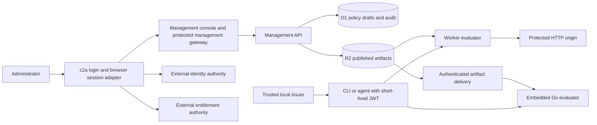

# Production readiness plan

Status: design proposal, 2026-11-04. Based on the current authz-worker checkout and source review of the three consuming projects. This is a work plan, not a claim that the system has passed a production security review. See [Project adoption](PROJECT_ADOPTION_PLAN.md) for repository-specific integration points and the revisions reviewed.

Architecture update: [c2a platform architecture](C2A_PLATFORM_ARCHITECTURE.md) and [evaluation](C2A_EVALUATION.md) define the governing boundary: c2a never stores users or owns their entitlement assignments. External services supply verified identity and grants; c2a owns credential issuance, policy evaluation, and delegation. The D1 identity/provisioning paths discussed below inventory the current implementation and need decoupling; they are not required target architecture. Existing token formats describe migration inputs. Use the newer documents for the replacement sequence and minimal embedded/Worker deployment.

## Recommended direction

Where shared management is needed, use one policy management plane per environment, with separate service definitions and audiences for JobDB, Gitvend, Cortex, and the management API itself. Embedded deployments can use local bundles and external identity/entitlement adapters without a management daemon. Keep request-time enforcement close to each application: a Cloudflare Worker for suitable HTTP services, and an embedded Go library for Go services and application-specific checks.

Use reusable c2a login and session adapters for Cortex and the administration console, with Google and other upstream identity connectors. Applications own their browser sessions and external services own accounts, identity linking, memberships, and entitlement assignments. Keep job and agent access headless: c2a local issuance by trusted operators, token requests, and offline capability attenuation. Move application permission and credential implementations into c2a while preserving Git protocol and JobDB lease semantics.

The main work is completing the integration and operational boundaries. The repository already has a substantial management service, publishing pipeline, authentication service, and Worker evaluator. Reuse those components where their contracts fit, while decoupling the existing local identity and entitlement stores from issuance.

## What exists, and what still needs work

| Area | Present in this repository | Required before adoption |
| --- | --- | --- |
| Policy management | Service vocabulary, scopes, subjects, groups, bindings, claim previews, simulation, React console | Production operator login; per-service administrative permissions; repeatable onboarding for real services |
| Distribution | Versioned R2 artifacts, manifests, caches, publication approval, replication status, configuration rollback | Distribution to non-Worker runtimes; explicit compatibility and freshness rules; recovery exercises |
| Worker enforcement | JWT/JWKS verification, compact claims, request mapping, Cedar evaluation, proxy and embedded APIs | Real gateway configurations; strict token profile validation; origin isolation and management gateway wiring |
| Authentication | Local login, refresh sessions, service-account tokens, OIDC ID-token exchange, MFA and provisioning components | Complete browser redirect/callback/session flow; production credential lifecycle; federation linking and replay review |
| Local tooling | Demo token scripts and the [c2a CLI proposal](../C2A_CLI_PROPOSAL.md) | A released CLI for local signing, key management, inspection, and evaluation; demo scripts are not this CLI |
| Go integration | No Go authorization SDK in authz-worker | Embedded evaluator, HTTP integration, artifact loader, application adapters, cross-runtime fixtures |
| Deployment | Staging/production examples, deploy/smoke scripts, verification CI | Real resource IDs/domains; deployment inventory for several services; actual release promotion and recovery |

Useful implementation anchors are [the runtime](../src/lib.ts), [authn service](../src/authn/service.ts), [management authentication](../src/management/worker.ts), and [deployment orchestrator](../scripts/cloudflare-deploy.mjs). Existing runbooks remain useful: [deployment](CLOUDFLARE_DEPLOYMENT.md), [operations](OPERATIONAL_HARDENING.md), and [composable adoption](COMPOSABLE_ADOPTION.md).

## Optional managed deployment



For this managed deployment, use shared D1 policy/operational storage and R2 artifacts within each environment, using the existing service namespace. Keep authoritative identity and entitlement storage external. This is one deployment option; local bundles and embedded evaluation do not require D1 or R2. Separate staging and production credentials, issuers, data, domains, and policy storage. Sharing a management plane must not imply shared permissions: a JobDB operator should not automatically administer Gitvend or the management service.

Create service IDs such as `jobdb-api`, `cortex-api`, `gitvend`, and `management-api`. A service identifies an API/security boundary; a scope identifies a tenant, project, or repository grouping within it. The three Git repositories are not themselves three interchangeable scopes. Record the actual tenant and repository mappings explicitly.

One Worker gateway per protected service is a straightforward first deployment. This matches the current single `SERVICE_IDENTIFIER` configuration and avoids building dynamic multi-service routing prematurely. Go applications load only their assigned service artifacts.

### Make deployment independent of the demo

The current orchestrator deploys the sample upstream and `wrangler.demo-authz.jsonc`. Authn examples allow `projects-api`; the UI defaults to `management-api`. These settings need coordinated replacement, not just new hostnames.

Add a checked-in environment/service inventory that describes each gateway, upstream, audience, scope resolver, artifact root, and secret reference. Generate or validate Wrangler configuration from it. Keep actual secrets outside that inventory. Configure both the console's management URL and authentication URL, and reject production builds with demo mode, embedded access tokens, placeholder IDs, or localhost endpoints.

Build the dedicated management gateway and its initial policy. The management Worker currently trusts actor headers only with `AUTHZ_GATEWAY_TOKEN`, or accepts the bootstrap bearer token. The generic proxy does not automatically supply that management trust secret. Wire the secret server-side, remove inbound copies of trusted headers, and prove that direct requests cannot impersonate an administrator. Protect service-global, scope-specific, and platform-wide management operations explicitly; some management routes have no project scope in their URL.

Provision initial identities and reviewer assignments in the external authorities, and configure service-account credentials, management policy, and at least two reviewers through a controlled, repeatable bootstrap procedure. Do not depend on the demo seed script: it calls the authn bootstrap route, which is disabled in deployed environments. Implement normal credential creation, rotation, and revocation without reopening bootstrap. Remove routine bootstrap access after setup and document recovery access.

Publication approvals already exist, but publication is not the only way to change access. External membership and binding changes affect newly issued tokens. Decide which entitlement mutations require review and enforce that in the owning service, including changes submitted through product UIs. Self-protection of the management service needs a tested recovery route if its policy is misconfigured.

## Token issuance and local use

### Keep token profiles explicit

| Token | Issuer and consumer | Initial approach |
| --- | --- | --- |
| Platform API access JWT | Platform authn or a specifically trusted local issuer → JobDB/Cortex/Worker evaluator | ES256 or RS256; exact issuer, audience, subject, times, `azv`, and `azs` |
| Existing Gitvend access JWT | Gitvend local signer or JobDB secret-provider plugin → Gitvend | Migration input: replace custom signing and grants with c2a issuance and permissions |
| JobDB execution lease capability | JobDB → JobDB lease operations and secret resolution | Extract proof and attenuation into c2a; retain authoritative lease facts in JobDB |
| Upstream OIDC ID token | Login provider → configured login callback/exchange | Identity proof for that client; never an application API token |

These profiles are not currently interchangeable. In particular, Gitvend's EdDSA/grant token does not satisfy the platform's default ES256/RS256 compact-claim contract. Sharing issuer tooling and administration does not require collapsing all formats into one JWT.

For platform access tokens, make required claims, algorithm allowlists, maximum lifetime, clock tolerance, token size, and compact-claim limits part of a versioned profile. The current `verifyJwt` call verifies JWTs but does not explicitly require all of the documented `exp`, `iat`, and `azv` fields. Reject missing expiry, unsupported authorization versions, malformed claims, unknown audiences, and unknown signing keys before policy evaluation. Add negative fixtures shared by Go and TypeScript.

Never recycle compact scope, role, or group identifiers while old tokens can reference them. Decide whether a role expansion should affect outstanding tokens immediately when policy reloads; version or invalidate claims when a change must not grant additional authority to previously issued tokens.

### Provide two CLI paths

1. **Local minting:** a trusted operator/issuer signs offline using an explicitly installed service signing key and a validated local entitlement snapshot. This directly supports the requested JobDB workflow. Verification uses configured public keys/JWKS and does not contact the issuer on every request.
2. **Token request:** the local CLI authenticates with its own narrowly scoped service-account credential and requests a short-lived token from authn. Ordinary clients and CI should use this when offline signing is unnecessary. The existing service-account endpoint supplies a starting point.

Proposed CLI surface, **not implemented commands**:

```text
c2a keys generate / public / rotate
c2a token mint --profile jobdb --subject ... --entitlements ... --key-file ... --out ...
c2a token request --service jobdb-api --credential-file ... --out ...
c2a token inspect / verify
c2a eval --bundle ... --request ...
```

Existing `gitvend keygen` and `gitvend sign` can support a bounded migration. The destination is c2a-owned issuance and permission computation, with the credential helper transporting c2a credentials. Add a separate local `attenuate` operation that uses a parent capability without an issuer signing key; see the architecture document for the required semantics.

A private signing key grants authority to issue claims; a friendly CLI cannot constrain a malicious or compromised key holder. Do not distribute the platform's general signing key to clients. Give trusted offline issuers dedicated keys and enforce their audience/scope/role ceilings in the verifier, or isolate an issuer to a deployment with an explicitly accepted trust boundary. This key-to-authority restriction is additional work for the platform. Unknown or unconfigured issuer profiles must fail closed.

Start with a proposed ten-minute platform access-token lifetime and Gitvend's existing configured short lifetime. Rotate keys with overlap, atomically replace token files with restrictive permissions, and keep tokens out of command arguments, URLs, logs, and browser storage. Publish public keys; keep private keys in the issuer's secret store or protected local files.

Offline minting has two independent freshness limits: the entitlement snapshot can be stale, and minted tokens remain valid until expiry. Reject stale snapshots and document the combined maximum removal delay. Bound temporary grants by their actual expiry when minting. Revoking a refresh session or disabling future issuance does not retroactively revoke an already signed JWT. A live revocation/entitlement-version check, or a propagated explicit deny, is required when expiry is not fast enough.

## Standardized browser login

Build reusable upstream OIDC login adapters for Cortex and the management console. The adapter verifies Google or another provider, resolves externally owned identity and entitlements, and requests audience-bound c2a credentials. The application owns its session. A downstream OAuth/OIDC provider is optional and should be added only when a consumer requires that protocol.

The [platform architecture](C2A_PLATFORM_ARCHITECTURE.md#reusable-components) lists upstream client and optional downstream protocol candidates. Select components for the required runtime and protocol; c2a owns issuance, policy configuration, and necessary protocol state, while external authorities own directory, identity-linking, and entitlement records.

Standardize the application adapter around `login`, `callback`, `session`, and `logout`. Cortex already has a Go server serving its UI, so it can act as the browser backend. Give the management UI a separate client registration, audience, and application session. Upstream SSO can be reused without sharing a broad cookie across applications. The sequence below does not require a downstream c2a OIDC server.

Proposed flow:

1. The browser requests login. The backend creates a short-lived login transaction and redirects to the provider using authorization code flow with PKCE, state, and an OIDC nonce.
2. The backend validates the callback and ID token against that transaction and its exact registered client. Use exact redirect allowlists and prevent replay. The redirect-flow design should follow [OAuth security BCP, RFC 9700](https://www.rfc-editor.org/rfc/rfc9700.html).
3. The verified external identity maps to a stable namespaced subject through the external identity authority. The backend obtains an audience-specific platform token bounded by current grants from the external entitlement authority.
4. Store refresh material server-side and return a host-scoped Secure, HttpOnly session cookie. Browser calls remain same-origin; mutations receive CSRF/origin protection. SSE and downloads use the session without putting bearer tokens into query strings.
5. Logout invalidates the application session and refresh capability; provider logout is a separate documented choice. Membership changes and session expiry must have defined effects on active streams.

`POST /auth/federated/oidc` currently exchanges an ID token but does not implement redirect transactions, nonce binding, or the browser session. Extend or wrap it behind an authenticated backend boundary, bind exchange to the completed login transaction, and restrict provider/client-to-target-audience mappings. Do not leave arbitrary replayable ID-token exchange as the new browser login protocol.

The current federation implementation can initially link by email and stores one external provider/subject pair on an identity. For multiple login providers, move identity mapping to the external identity authority, keyed by stable issuer/provider plus subject. Account linking must be an explicit authenticated operation owned by that authority. Start with invited/provisioned users; a successful Google login must not automatically create project access or management privileges.

## Embedded Go authorization library

Build a Go module provisionally called `c2authz`; its final module path is a packaging decision. It should provide both `net/http` middleware and a callable `Authorize(ctx, request)` API. Business operations, Git ref updates, and JobDB acquisition need explicit checks even when HTTP middleware exists.

Use [`github.com/cedar-policy/cedar-go`](https://github.com/cedar-policy/cedar-go) as the first evaluator candidate. Its documented authorizer supports native Go embedding, but its feature set differs from Rust: policy templates and partial evaluation are absent, and schema validation is experimental. Pin a tested version and prove compatibility with the subset we publish. Keep authoritative schema validation in the existing publishing path. The platform's role templates are a separate concept from Cedar policy templates and should be expanded consistently before evaluation.

The SDK owns:

- Strict JWT verification, public-key refresh, and typed identity in request context.
- Platform compact-claim parsing, role/group expansion, policy assembly, scope/resource/context construction, and Cedar evaluation.
- Authenticated artifact loading with local disk snapshots, bounded caches, atomic activation, and compatibility checks. Start with an authenticated HTTPS artifact endpoint; Go services should not need broad R2 write credentials.
- Middleware hooks for application routing and authoritative resource lookup; explicit authorization for non-HTTP operations and result filtering.
- Structured decisions and audit metadata: subject, service, scope, action, resource, result, policy versions, and correlation ID. No raw JWTs or secret payloads.

Ship a signed or otherwise authenticated bundle index that identifies compatible service and scope versions and content digests. Load complete verified snapshots before activation. On a cold start without usable artifacts, deny protected operations and fail readiness. For an outage after successful loading, allow a documented bounded last-known-good window, then fail closed. Select those windows against the promised revocation delay; a replica bucket alone is not an automatic failover strategy.

Define portable descriptor semantics: the current JavaScript regular expressions cannot simply be copied into Go's regexp engine. Choose a common route-template/regex subset and test URL decoding, path normalization, body extraction limits, and duplicate/conflicting tenant selectors. Prefer router-provided identifiers over reading large request bodies in middleware.

Run the same golden requests, JWT failures, entities, and policy bundles through Worker and Go implementations. Cover deny precedence, no matching policy, evaluation errors, group nesting, namespace/path grants, tenant isolation, temporary grants, and stale artifacts. Specify how evaluation diagnostics affect the application decision and enforce the same rule in both runtimes. If required Cedar features cannot achieve parity, evaluate a Rust-based adapter behind the same interface before enabling those features in production.

## Operational requirements and rollout

Protect origins so public callers cannot bypass a gateway. Keep direct Go listeners behind TLS ingress or use the embedded evaluator on every exposed route. Strip caller-supplied trusted identity headers. Separate liveness from readiness: a process can be alive while unable to verify keys or load policy.

Add deployment promotion to the existing verification CI, pin released artifact/SDK versions, and record migrations and policy versions with each release. Exercise D1 backup/restore, R2 artifact recovery, signing-key rotation, configuration rollback, and recovery from a bad management policy. Set proposed initial objectives for authentication success, authorization latency, policy propagation, and recovery; measure them under actual workload before making availability promises.

Export decision and control-plane audit records to a retained sink. Alert on verification failures, publication failures, stale policy, dirty projections, replication failures, unexpected privileged grants, and increased authorization errors. Apply issuance/login rate limits and payload limits. Load tests must include JobDB polling and artifacts, Git pack transfers, and Cortex SSE rather than only small JSON requests.

| Phase | Deliverables | Exit evidence |
| --- | --- | --- |
| 1: Contracts and staging foundation | Service/audience registry, scoped management gateway, non-demo deployment inventory, bootstrap and credential lifecycle | Real operator identity; cross-service denial; direct-origin spoofing denied; repeatable staging provision |
| 2: First machine service | Go SDK minimum, strict token profile, local JobDB signer, JobDB authority adapter, policy delivery | Tenant/cell isolation; lease behavior preserved; Go/Worker parity fixtures; expiry and rotation tested |
| 3: Gitvend adoption | c2a permission and credential modules integrated with the existing Git protocol parser and JobDB plugin | Allowed ref update works; forbidden update denied; lease-bounded issuance and deny preservation verified |
| 4: Browser access | Upstream OIDC adapters, external entitlements, application-owned sessions, Cortex and console integration | Google login; invitation denial; CSRF/replay/logout tests; tenant/SSE/download isolation |
| 5: Production promotion | Backups, monitoring, bounded outage behavior, load evidence, rollback/recovery exercise | One limited tenant/project live first, then expand after observing actual usage |

Phases 3 and 4 can proceed independently once the relevant contracts are fixed. Do not hold a useful Gitvend deployment behind completion of a universal SDK migration. Conversely, deploying the existing demo to a production hostname does not satisfy phase 1.

Decisions still needed during implementation: hosting and domain ownership, login adapter components and runtime, the initial tenant/cell/repository inventory, offline issuer owners, acceptable access-removal delay, and deployment/recovery responsibility. The architecture document adds the capability-profile and cross-service delegation decisions.
