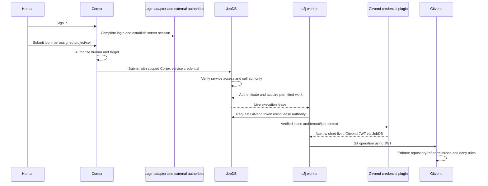

# Adoption plan for JobDB, Gitvend, and Cortex

Status: proposed integration, 2026-11-04. Read alongside [Production readiness](PRODUCTION_READINESS_PLAN.md). Existing capabilities below were checked against source; suggested role names, token commands, SDK APIs, and new endpoints are proposals unless explicitly described as existing.

Architecture update: [c2a platform architecture](C2A_PLATFORM_ARCHITECTURE.md) and [evaluation](C2A_EVALUATION.md) supersede the initial conservative strategy. We intend to replace independent credential/enforcement implementations with c2a, including JobDB's macaroon delegation. User storage, memberships, and entitlement assignments remain in external application-owned services permanently; c2a requests grants and issues/enforces authority. The source inventory and application enforcement points below remain useful, but references to c2a-owned user administration are superseded.

## Source baseline and overall shape

Reviewed public repository snapshots:

| Repository | Revision | Relevant sources |
| --- | --- | --- |
| JobDB | `a21636d234cef6e241dcc1e2da41fe209b8f3ac5` | [README](https://github.com/colony-2/jobdb/blob/a21636d234cef6e241dcc1e2da41fe209b8f3ac5/README.md), [HTTP server](https://github.com/colony-2/jobdb/blob/a21636d234cef6e241dcc1e2da41fe209b8f3ac5/pkg/jobdb/runtime/remote/server.go), [cell authority](https://github.com/colony-2/jobdb/blob/a21636d234cef6e241dcc1e2da41fe209b8f3ac5/pkg/jobdb/cells.go), [OpenAPI](https://github.com/colony-2/jobdb/blob/a21636d234cef6e241dcc1e2da41fe209b8f3ac5/openapi/jobdb-runtime.yaml) |
| Gitvend | `74c1886489258393685c58c38fedb6a890cf1601` | [Gateway guide](https://github.com/colony-2/gitvend/blob/74c1886489258393685c58c38fedb6a890cf1601/docs/gateway.md), [JWT verifier](https://github.com/colony-2/gitvend/blob/74c1886489258393685c58c38fedb6a890cf1601/internal/auth/auth.go), [JobDB plugin](https://github.com/colony-2/gitvend/blob/74c1886489258393685c58c38fedb6a890cf1601/docs/jobdb-secret-provider.md) |
| Cortex | `86f850a6d0791374641161348ab99c0457268153` | [README](https://github.com/colony-2/cortex/blob/86f850a6d0791374641161348ab99c0457268153/README.md), [routes](https://github.com/colony-2/cortex/blob/86f850a6d0791374641161348ab99c0457268153/server/internal/cortex/server.go), [browser identity](https://github.com/colony-2/cortex/blob/86f850a6d0791374641161348ab99c0457268153/web/shared/src/auth.ts), [review response identity](https://github.com/colony-2/cortex/blob/86f850a6d0791374641161348ab99c0457268153/server/internal/cortex/reviews.go) |

The source review did not deploy or run these projects. Cortex pins JobDB `v0.0.65` in its reviewed Go module; JobDB's default branch is a separate snapshot. Coordinate dependency upgrades and confirm the exact release contracts before implementing adapters, especially the newer cell model. The reviewed JobDB README describes that cell release as requiring fresh execution storage and coordinated client upgrades; plan a separate migration or fresh deployment rather than assuming an in-place upgrade is supported.

| System | Identity entry point | Recommended first enforcement | Shared management responsibility |
| --- | --- | --- | --- |
| JobDB | CLI/worker service identity and short-lived JWT | Embedded Go evaluator plus JobDB's existing cell and lease authority | Tenant/cell permissions, worker/submitter roles, service identities, issuance policy |
| Gitvend | Locally signed Gitvend JWT; existing JobDB plugin | Existing Go gateway and Git protocol checks | Repository/ref grants, issuer ceilings, deny rules, policy revisions |
| Cortex | Google/other provider through standardized OIDC login and server session | Go session middleware and embedded authorization | Policy vocabulary and privileged actions; memberships and assignments remain external |

Product-specific UIs should reuse shared APIs to inspect vocabulary, simulate, review changes, publish, and inspect audit. Assignment and membership changes go to the external entitlement authority. A universal console is optional. It should not imply that granting Cortex access automatically grants a worker credential or a Git push permission. Model cross-service mappings deliberately and show their effects before approval.

## JobDB: protect the existing serving layer

### Existing foundation

JobDB already serves a runtime REST API and publishes an OpenAPI contract. It has execution lease tokens, delegation and lease-scoped secret resolution, plus a `CellAuthority` context mechanism for cell operations, submission, listing, and acquisition. Its configuration CLI already accepts `JOBDB_BEARER_TOKEN` for deployments that enforce authentication. There is no need to invent another job server.

The integration is an authenticated serving profile around the existing remote server, together with a trusted identity-to-authority adapter. A valid platform JWT grants application access; it does not replace a live JobDB execution lease.

### Proposed scope and permission model

Use service `jobdb-api`. Map each JobDB tenant to a scope with an exact, stable mapping; represent cells by their stable cell IDs. Cell names can change and old names remain aliases, so do not use a mutable name as the only permission identity. Resources include cells, jobs, artifacts, schedules, configuration, and secret names.

Start with a small role set:

| Role | Intended authority |
| --- | --- |
| Observer | List/read permitted jobs, stories, and artifacts within assigned tenants/cells |
| Submitter | Submit into permitted cells and explicitly allowed cancel/restart operations |
| Worker | Acquire permitted work and use the resulting live lease for execution operations |
| Tenant administrator | Manage cells/configuration and explicitly authorized tenant operations |
| Secret administrator | Manage secret configuration; separate from general read or job submission |

These are starting policy templates, not existing JobDB role names. Keep destructive deletion, secret administration, and broad worker acquisition as separately grantable actions. A reader of job output must not gain access to tenant secrets.

### Integration work

1. Add the shared Go verifier/evaluator to the HTTP server composition. Import the OpenAPI operations into the management vocabulary, then explicitly define action/resource/scope mappings. Inventory admin and plugin routes as well as generated REST routes; deny unmapped protected routes.
2. Derive tenant identity from the routed tenant and validated body where needed, and verify resource ownership from stored records. Never allow an `x-scope-id` header to override the actual tenant. Polling at `/v1/jobs/poll` is not tenant-scoped in its path and requires its own mapping and acquisition restrictions.
3. Populate `jobdb.WithCellAuthority` only from verified identity and policy decisions. Its `Cells == nil` means all cells, while an empty map means none: make that distinction explicit in the adapter. The authority applies a permission set across its cell set; do not flatten different per-cell grants into a union that broadens access. Use an exact representable subset or extend the authorization hook for per-cell decisions.
4. Enforce authorization before list pagination and before acquiring work. Reject or constrain unauthorized multi-tenant/cell queries without leaking results, counts, or acquiring a lease and then discarding it. Cover history, mutation, goals, artifacts, and configuration separately; `CellAuthority` explicitly is not complete resource-wide RBAC.
5. During migration, preserve `X-JobDB-Lease-Token` and existing checks for tenant/job/worker/lease, expiry, delegation, and renewal. Establish a trusted principal during acquisition and propagate it into lease and secret-provider authority. Do not take this principal from request metadata. Define how worker access revocation interacts with already active leases and cleanup operations.
6. Add token-file/token-provider support to remote clients and workers, with refresh for long-running workers. Check Cortex and c2j client construction too; an environment variable supported by an administrative CLI does not prove every remote runtime client uses it.

Local use should become: provision a tenant and narrow identity; publish policy; install the public issuer key; mint a short-lived JWT locally; point the CLI/client at the protected server; verify one allowed and one denied request. The c2a signer described in the readiness plan is new work. Keep lease-token signing separate from the platform access-token signing key.

A Cloudflare gateway can front JobDB for TLS, ingress controls, and coarse request authorization, but it cannot by itself populate Go context or authorize internal acquisition and result sets. If deployed, keep the origin private and retain the application adapter. Benchmark polling and artifact streaming before choosing an extra proxy hop.

Acceptance cases: tenant A token denied in tenant B; observer cannot submit or alter config; worker cannot acquire another cell; mixed-cell query stays restricted before pagination; a valid API token cannot substitute for a wrong/expired lease; secret access remains lease-bound; key rotation and token expiry do not silently disable enforcement.

## Gitvend: migrate existing semantics into c2a

### Existing foundation

Gitvend already implements much of the requested machine-access workflow: an HTTPS Go gateway, local `keygen` and `sign` commands, a Git credential helper, repository/ref grants, issuer owner ceilings, global denies, and an optional JobDB secret-provider plugin. It holds the upstream GitHub credential while agents receive scoped short-lived JWTs.

Its JWT profile uses Ed25519, `typ=gitvend+jwt`, and `grant.permissions`. A platform compact-claim JWT will not work as a drop-in replacement. A bounded migration can accept the existing profile; the destination is c2a issuance, canonical permissions, and shared verification rather than permanent format isolation.

### First deployment

Run the existing binary/container behind HTTPS, with public verification keys and upstream credentials supplied by the host's secret mechanism. Operators and the JobDB plugin keep private issuer keys. Agents receive only token files and use the existing credential helper; refresh files before expiry.

Use explicit owner/repository allowances for the initial projects. Separate permission to create repositories from permission to write branches, and require an explicit decision before enabling automatic repository creation. Keep protected-branch denies in the serving layer. The existing guide's wildcard examples are demonstrations, not a suitable default permission inventory for these services.

A real smoke test should clone/fetch an allowed repository, push an allowed disposable branch, and reject a forbidden ref update. `/healthz` is only liveness. Retain upstream GitHub permission and branch-rule checks.

### Management integration

Represent repository and ref capabilities in product administration, but keep their Git semantics intact. Model read/discovery, ref update, ref deletion, and repository creation separately. Gitvend's pattern grammar is not the platform's filesystem path-prefix grammar; do not convert one to the other by string replacement.

A versioned Gitvend policy projection/export can bridge a staged deployment, but it should not become the final integration. Move repository/ref grants, issuer ceilings, and deny evaluation into c2a's permission module and register Git-specific selector semantics there. Include policy revision metadata in issued authority and audit. Private GitHub credentials and signing keys remain secret references, never policy-bundle contents. Define exactly when a revision becomes active on issuer and gateway; management publication alone is not proof that both have loaded it.

The JobDB plugin is the natural first consumer of managed issuance policy. Preserve its existing distinction between base permissions and target-cell permissions narrowed to the selected repository. Its dynamic token expiry must stay within the broker-verified lease authority. Submitted metadata can influence the target repository, so intersect that target with trusted tenant policy and preserve deny semantics; metadata must never grant authority by itself.

The shared Go SDK should become the authorizer for structured Git operations inside Gitvend. Integrate at the existing parsed-protocol decision points: a single receive-pack request can update several refs, and every update needs approval before forwarding. Do not reduce that decision to `POST /repo/git-receive-pack` being allowed. Test discovery filtering, object reads, pushes, deletes, tags, and creation separately.

Branch/ref visibility is not Git object confidentiality: a repository read grant may permit fetching objects by known hash if the upstream serves them. Use separate repositories for confidentiality boundaries. Do not market Cedar branch policies as making existing Git object access more restrictive than the underlying gateway guarantees.

Keep Cloudflare optional as ingress here. Gitvend must retain the Basic credential containing its JWT, `Git-Protocol`, and streaming semantics. Measure pack sizes and transfer timeouts before putting another proxy in the path; preserve Gitvend's transport limits and do not redirect Git clients to interactive login.

Acceptance cases: unknown key/audience rejected; native local token works; a token cannot escape its key's owner ceiling; global deny wins over a grant; one forbidden ref rejects the whole push before forwarding; expired lease cannot issue a usable new credential; token rotation works through the existing credential helper. Stopping renewal is not immediate revocation of an issued token.

## Cortex: real login, then project authorization

### Existing foundation and boundary

Cortex is a Go API plus embedded React UI backed by remote JobDB. Its projects map to JobDB tenants. The reviewed UI considers a JavaScript-written email cookie sufficient to appear signed in, and review submission derives its actor from that cookie. The README explicitly says this is not server-side authentication.

Replacing the email screen with a Google button alone would leave that boundary unchanged. Implement verified server sessions, then derive both permissions and audit actor from those sessions. Keep email as display/contact information rather than the stable security identity.

### Login and request flow

Reuse the [standard browser-login design](PRODUCTION_READINESS_PLAN.md#standardized-browser-login): a reusable upstream login adapter, external subject mapping and entitlement lookup, and a Secure/HttpOnly application-owned session. Additional providers use the same adapter contract; account linking remains in the external identity authority. A downstream c2a OIDC server is not required.

The browser calls the same-origin Go backend. The backend verifies the session and evaluates `cortex-api` permissions with the shared Go SDK. Store refresh material server-side; use the session for SSE and downloads. Do not pass the provider's ID token directly to JobDB or put an access token into an EventSource URL.

Add a session endpoint returning the stable subject, display identity, and permitted project choices. Start with invitations/provisioned membership; an authenticated user with no assignments sees no projects. The management console can reuse the login implementation but must have its own audience and administrator assignments.

### Authorization surface

| Surface | Required behavior |
| --- | --- |
| Project listing and tenant selector | Return only assigned projects; URL/query changes must not grant membership |
| Jobs, goals, stories, chapters, outcomes | Check the selected tenant and actual job ownership; paginate only authorized results |
| Artifacts and review documents | Check project/job access for every download or preview |
| Job submission | Require a submit permission and an allowed target cell/repository; arbitrary repository entry is not authorization |
| Cancel, restart, delete | Separate mutation actions, with delete independently grantable |
| Pending inputs and reviews | Authorize read/respond separately; attribute responses to the verified stable subject |
| SSE | Check subscription membership and bound stream lifetime/recheck access; no cross-tenant events |
| c2j-provided input routes | Apply the same authentication and authorization to routes mounted outside the main `/api` subrouter |

That final row matters in the reviewed router: `inputService.GetRoutes()` handlers are mounted directly on the outer router. Attaching middleware only to the `/api` subrouter could leave them uncovered. Inventory all registered routes and explicitly allow only login/callback, static assets, and minimal health access without a session.

Suggested roles are project viewer, submitter, reviewer, operator, and project administrator. Keep review response authority distinct from authority to run or delete jobs. Validate object-to-project relationships server-side and use consistent not-found/forbidden behavior where identifiers could reveal another tenant's data.

### Cortex-to-JobDB trust

The target is c2a-authorized delegation/exchange for human-initiated JobDB actions. A staged rollout can use Cortex service credentials constrained to the tenants/actions it serves, with Cortex explicitly trusted to authorize the user first. Do not give it an unrestricted installation-wide token by default.

JobDB authenticates Cortex as the service actor; Cortex records the human actor in its own audit. Treat this as an explicit trust decision: JobDB cannot independently verify the human just because Cortex adds an identity header. Protect the credentials and limit the consequence of a Cortex compromise.

Implement an authenticated c2a delegated-token exchange that issues `jobdb-api` authority with bounded user permissions and a recorded Cortex actor. This is additional work, not an existing endpoint. Never forward a `cortex-api` token to JobDB and loosen audience validation to make it pass. The architecture document defines how cross-service exchange differs from local attenuation.

Coordinate c2j and JobDB dependency versions, client token transport, tenant/cell discovery, and trusted response actors. The shared authz library cannot resolve those application contracts automatically.

Acceptance cases: a forged email cookie grants nothing; Google login without an invitation grants no project; editing a project ID cannot cross tenants; a viewer cannot submit/restart/delete/respond; direct downloads and c2j input routes remain protected; review audit contains the verified subject; session expiry/logout stops new requests and has a bounded effect on streams.

## How the systems fit together

Product-owned entitlement services supply assignments, and c2a policy management supplies reviewed policy configuration to these enforcement and issuance points. It does not need to be called synchronously for every Git operation or job API request. The complete path should carry correlation IDs and distinguish the human requester, Cortex service actor, worker, lease, and Gitvend token subject.

Use the [architecture migration sequence](C2A_PLATFORM_ARCHITECTURE.md#migration-and-a-useful-first-proof): extract capability handling and permission enforcement into c2a, make JobDB a native consumer, integrate reusable login adapters and external entitlements for Cortex, and move Gitvend to canonical c2a authority. Existing formats can support a bounded transition. Demonstrate one tenant's full login → submit → acquire → scoped Git access flow and a second tenant that is consistently denied, including child attenuation and parent-lifecycle tests.
