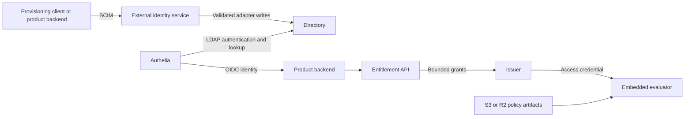

# SCIM and the boundaries between identity and authorization

Status: external-directory and administration options assessment. Product UIs and product-owned grant storage complement the [platform architecture](C2A_PLATFORM_ARCHITECTURE.md). The provider candidates below are dated research, not selected or tested deployment dependencies.

Design recommendation dated 2026-11-04. This refines [Grant management options](GRANT_MANAGEMENT_OPTIONS.md) around Authelia for authentication and product-specific management UIs. It is a component assessment, not a tested deployment recipe.

## Directory system recommendation

The clarified requirement is a complete external user/group directory with SCIM, not merely a SCIM library. Directory membership feeds authorization as well as authentication. Under that requirement, **Authentik OSS is my first complete-system prototype; Casdoor is the smaller Go-oriented candidate to investigate.** The library options below remain useful integration tools, but they do not meet the directory requirement on their own.

### First choice to prototype: Authentik OSS

Authentik supplies an actual user/group store, administration and lifecycle management, an inbound SCIM source, and an outbound SCIM provider. The source receives user/group provisioning; the provider propagates changes to downstream applications. Its LDAP provider exposes the same directory's users and groups, giving Authelia a possible authentication and lookup interface without constructing another account database. [User management](https://docs.goauthentik.io/users-sources/user/), [groups](https://docs.goauthentik.io/users-sources/groups/), [inbound SCIM](https://docs.goauthentik.io/users-sources/sources/protocols/scim), [outbound SCIM](https://docs.goauthentik.io/add-secure-apps/providers/scim/), [LDAP provider](https://docs.goauthentik.io/add-secure-apps/providers/ldap/).

Its core is MIT-licensed, with separately licensed enterprise code. The basic SCIM source/provider and LDAP functionality are available in OSS; OAuth authentication for outbound SCIM is specifically documented as Enterprise, while static-token authentication is the default. This recommendation uses the self-hosted OSS functionality, not a paid hosted service or an assumption that all features are MIT. [License boundaries](https://github.com/goauthentik/authentik/blob/main/LICENSE), [SCIM authentication modes](https://docs.goauthentik.io/add-secure-apps/providers/scim/).

The cost is operational: the documented installation includes a server, background worker, and PostgreSQL. Exposing LDAP adds an LDAP outpost. Keeping Authelia then adds another service. This is a complete identity system, but does not satisfy the ideal of a tiny directory-only binary. It runs separately from Cloudflare; c2a's evaluators can still run on Workers. [Installation components](https://docs.goauthentik.io/install-config/first-steps/), [outpost deployment](https://github.com/goauthentik/authentik/blob/main/website/docs/add-secure-apps/outposts/manual-deploy-docker-compose.mdx).

Authelia-to-Authentik integration is a proposed LDAP composition, not something tested here. Validate schema/filter mapping, service-account access, disabled-user binds, and membership visibility. Authentik also supplies login itself; retaining Authelia is a supported architectural preference to investigate, not a requirement of c2a. If the combined operational cost is excessive, using Authentik directly for OIDC would remove that extra hop.

### Smaller deployment candidate: Casdoor

Casdoor is Apache-2.0, uses Go, supports SQLite, and serves its built frontend from the backend in production. It documents users/groups through SCIM and a built-in LDAP interface. Those are attractive characteristics for the desired deployment. Its broader IAM and permission features need not become the authorization authority for these products. [License](https://github.com/casdoor/casdoor/blob/master/LICENSE), [deployment/storage](https://casdoor.ai/docs/basic/server-installation/), [SCIM resources](https://casdoor.ai/docs/scim/overview/), [LDAP configuration](https://casdoor.ai/docs/ldap/config/).

However, the source review on 2026-11-04 found a concrete question to resolve: `user2resource` emits an `active` value, but the reviewed SCIM schema, incoming resource conversion, and PATCH switch did not expose a corresponding `active` update path. That suggests `active=false` provisioning may not deactivate the account as expected. This is a source-level concern, not a reproduced runtime result. Verify the selected release before relying on it; implement or upstream the missing behavior if confirmed. [SCIM schema](https://github.com/casdoor/casdoor/blob/master/scim/server.go), [resource conversion](https://github.com/casdoor/casdoor/blob/master/scim/util.go), [PATCH handling](https://github.com/casdoor/casdoor/blob/master/scim/user_handler.go).

Thus Casdoor is a promising footprint fit, but I would not currently describe it as a verified drop-in SCIM lifecycle solution. Do not infer outbound provisioning support from the existence of inbound endpoints or an import syncer, either.

### Why not the other candidates first?

Kanidm is an actual identity system with users/groups and an LDAP interface. Its MPL-2.0 license differs from the permissive-license preference, and its documented synchronization model needs a separate compatibility assessment for the intended SCIM clients. Its LDAP login uses POSIX credentials, adding a further consideration when pairing it with Authelia. It is worth considering if those choices are acceptable, but not my first recommendation for this exact composition. [License](https://github.com/kanidm/kanidm/blob/master/LICENSE.md), [synchronization](https://github.com/kanidm/kanidm/blob/master/book/src/sync/concepts.md), [LDAP behavior](https://kanidm.github.io/kanidm/stable/integrations/ldap.html).

GLAuth supplies directory infrastructure but not the complete SCIM/user-management package requested. Elimity and SCIMMY supply protocol code. Choosing any of those as the answer would still leave us building a significant part of the identity system.

## How directory groups become c2a roles

Assume c2a administration is a library imported into each product, with grant persistence owned by that product and policy artifacts published to S3/R2. A separate c2a directory or mandatory centralized management daemon is unnecessary.

```text
External directory: user U belongs to group G
Product binding:    group G has role reviewer in Cortex project P
Product role:       reviewer permits review.read and review.submit
Issuer:             resolves that membership and binding into bounded grants
c2a evaluator:      enforces those grants, policy, resource facts, and caveats
```

This is where SCIM matters downstream: a provisioned membership change can alter the roles the product resolves for a user. c2a must support consuming trusted membership information as part of grant resolution, not merely accept a login identity.

For these three projects, start with a shared directory adapter that resolves account state and effective group IDs through authenticated directory APIs/LDAP. Product backends pass these facts to their imported c2a administration/entitlement code. That avoids requiring every product to maintain a SCIM replica. Where a product needs provisioning notifications or local identity data, use the directory's outbound SCIM to a product-owned receiver; c2a still owns no user store.

Keep group identifiers stable and namespace them by directory/organization. Explicitly decide whether nested membership is expanded by the directory or the adapter. A group rename must not silently remove access, and recreating a deleted name must not inherit old grants.

Group administration is now authorization-sensitive: someone who may add members to a privileged group can indirectly grant its product roles. Protect those writes accordingly. Authentik's inbound SCIM documentation describes a high-trust provisioning scope with tenant-wide correlation; do not hand that credential to a product UI expecting narrow project-level administration. Product grant administration and directory administration remain distinct privileges.

Membership removal must stop newly resolved grants after the declared lookup/synchronization delay. Existing JWTs or macaroons still need their expiry, revocation, or live-check contract; directory deactivation alone is not instantaneous downstream revocation.

## Three domains, with two parts inside authorization

Yes: authentication, authorization, and user management are useful top-level boundaries. They do not imply three mandatory servers.

| Domain | Responsibility | Proposed implementation |
| --- | --- | --- |
| Authentication | Establish identity, login, MFA, identity tokens | Authelia; applications integrate through OIDC |
| User/group management | Accounts, directory groups, activation/deactivation, provisioning | External directory or product identity service, with an off-the-shelf SCIM protocol implementation |
| Authorization administration | Resource/action schemas, roles, scoped grants, policy testing, publication | Shared APIs and contracts; product-specific UIs |
| Authorization evaluation | Enforce the credential ceiling, policy, trusted resource facts, and live restrictions | Embedded Go or Worker runtime; optional remote evaluation |

The last two rows are both authorization. Separating them lets administration be centralized while request decisions remain local. Token issuance and attenuation sit at the boundary: issuance consumes verified identity and externally resolved grants; validation enforces the resulting credential's limits.

User storage remains outside c2a. Storing a grant to an external subject/group is not account storage. Profile fields, passwords, recovery, and directory-group membership should not gradually migrate into the authorization service just because its UI wants to display people.

## SCIM can be reused, but it is a protocol rather than a directory

SCIM standardizes identity-resource schemas and HTTP provisioning operations. It does not provide a login flow, select the authoritative account database, or define the meaning of application permissions. Inbound SCIM means receiving provisioning changes; outbound SCIM means pushing them into another system. Adopting a server library does not automatically provide a synchronization engine for the other direction. [SCIM protocol](https://www.rfc-editor.org/rfc/rfc7644).

The short list I would evaluate is:

| Component | License | What is reusable | Work remaining |
| --- | --- | --- | --- |
| [elimity-com/scim](https://github.com/elimity-com/scim) | MIT | Go SCIM server framework, discovery/schema endpoints, resource CRUD/PATCH hooks | Resource handlers, persistence, authentication, tenant boundaries, lifecycle semantics, and interoperability tests |
| [SCIMMY](https://github.com/scimmyjs/scimmy) | MIT | JavaScript schemas, messages, resource processing; companion Express routing package | Storage handlers and endpoint integration; Worker compatibility must be verified |
| [SimpleIdServer.Scim](https://simpleidserver.com/docs/scim/quickstart/) | Apache-2.0 | Separately usable ASP.NET Core SCIM package/templates and persistence options | Operate/configure the service and connect its data to the actual identity backend |

Elimity is my first Go prototype candidate. Its README explicitly excludes some optional functionality, including bulk and sorting, and leaves some attribute rules to handlers. Treat it as maintained protocol code to evaluate, not a promise that every provisioning client will work without adaptation. It does not bring a complete account service. [Supported features and implementation responsibilities](https://github.com/elimity-com/scim).

SCIMMY documents Node.js as its runtime and leaves resource storage to the integrator. Its Express router is not a Worker integration. It is a candidate for reusing JavaScript protocol logic, not a verified Cloudflare solution. [README](https://github.com/scimmyjs/scimmy/blob/main/README.md), [MIT package declaration](https://github.com/scimmyjs/scimmy/blob/main/package.json).

If “off the shelf” means a ready-to-configure server implementation rather than a library, SimpleIdServer's SCIM component is closer. It can be used separately from the project's identity server, but introduces .NET hosting and storage. The project's license is [Apache-2.0](https://github.com/SimpleIdServer/SimpleIdServer/blob/master/LICENSE). [i2scim](https://i2scim.io/) is another Apache-2.0 server candidate with a configurable schema/provider architecture; its documented Kubernetes-oriented deployment and persistence integration are less aligned with the simplest Go/Worker setup.

## The Authelia integration needs an explicit adapter

Authelia's documented authentication backends are file and LDAP. A generic SCIM service is not directly interchangeable with either. Keep Authelia as the preferred authentication component, but do not assume “both support identity standards” means their stores automatically connect. [Authelia backends](https://www.authelia.com/configuration/first-factor/introduction/).

A possible arrangement is:



The SCIM-to-directory adapter is integration work unless the selected directory product explicitly supplies that bridge. Prefer one authoritative account store exposed through the required interfaces. A separate SCIM database and LDAP database introduce synchronization, reconciliation, and failure behavior that would otherwise be unnecessary.

A file backend is simpler for a few manually managed accounts, but writing it through SCIM still requires careful update handling and coordination with password changes. Provisioning an account record also does not automatically enroll a usable authentication method.

Define these contracts before selecting the storage adapter:

- Mapping among SCIM resource IDs, external IDs, directory IDs, and OIDC issuer/subject. These are not automatically the same value; email is not a safe universal join key.
- Which authority owns each group's membership and whether a provisioning client may modify it.
- Tenant isolation for all provisioning operations, including filter searches and group-member references.
- Deactivation effects on new login, existing sessions, token issuance, and already-issued credentials. Those effects have different propagation delays.

None of this requires c2a to store users. Put the adapter in the external identity service or product-owned identity layer.

## Cerbos embedding: possible, with the wrong default dependency for us

Cerbos does have embedded evaluation. Its documented ePDP executes Wasm locally, with policies obtained from Cerbos Hub. The ordinary open-source PDP is deployed as a service. Therefore “Cerbos cannot be embedded” is inaccurate, but it is also not the straightforward independently operated Go/Worker library path we want. [Embedded PDP documentation](https://docs.cerbos.dev/cerbos-hub/deployments-epdp-rules.html).

For this project, Cedar's existing Worker integration and a compatible Go implementation remain the more natural starting point. Keep OPA as the main alternative for an embedded engine plus bundle ecosystem. Do not interpret a service's Go client SDK as an embedded evaluator.

## Custom UIs narrow the useful shared surface

The goal need not be one console that understands every product. Standardize the backend concepts and let each UI express its own tasks:

- Cortex: add a reviewer or operator to a project.
- JobDB: grant a service identity access to specified tenants/cells and permitted operations.
- Gitvend: grant repository/ref access with the correct operation restrictions.

These can share APIs for service vocabulary, scoped bindings, effective-grant lookup, decision previews, publication, and audit. Each service still owns its resource facts and operation semantics. A Git ref restriction and a JobDB live lease must not be reduced to an ambiguous generic role string.

The UI may read directory data through an authenticated backend for person/group selection. Its backend submits grant changes under the administrator's verified authority. Every management write must enforce that administrator's scope and grantable ceiling; a privileged backend credential must not accidentally bypass those checks.

Use SCIM for standard user/group provisioning. Use the authorization API for roles, scoped grants, Cedar schemas, and policy publication. SCIM's extensibility does not make arbitrary application role meanings interoperable.

## Recommended next step

Prototype Authentik OSS as the external directory and verify Authelia against its LDAP provider. Test SCIM create/update, membership PATCH, filtering/pagination, duplicate identities, deactivation, and forbidden cross-tenant references with the intended provisioning client. If that deployment is too large, evaluate Casdoor next with the identified lifecycle gap explicitly in scope; do not fall back to building a directory around a SCIM library by accident.

In parallel, specify c2a's grant-management API independently of its console and account storage. Demonstrate a product UI changing a scoped grant, the issuer obtaining it from the entitlement authority, and Go/Worker evaluators enforcing a published policy snapshot. This gives us reusable components without requiring every product to inherit a universal UI or a fleet of authorization daemons.
